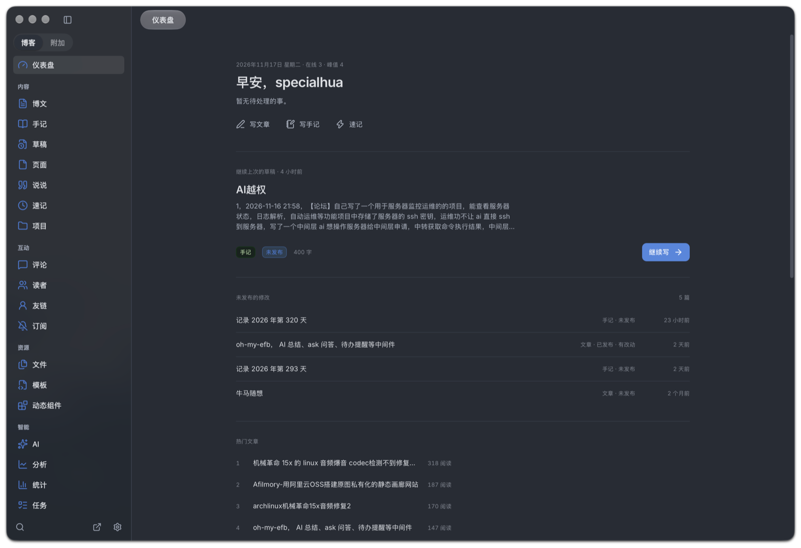
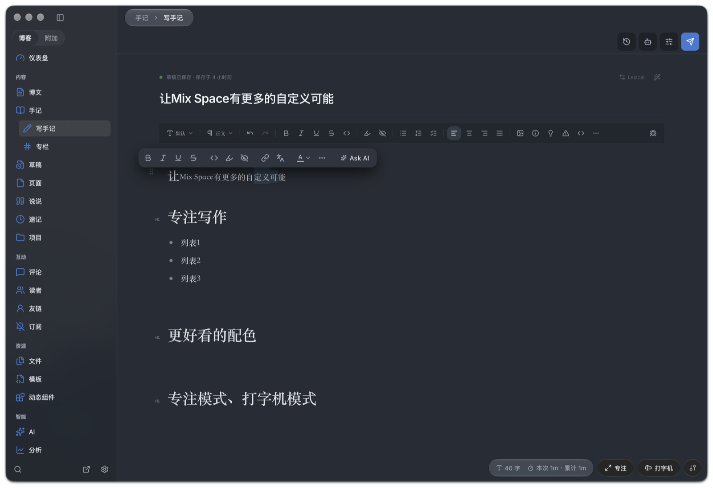
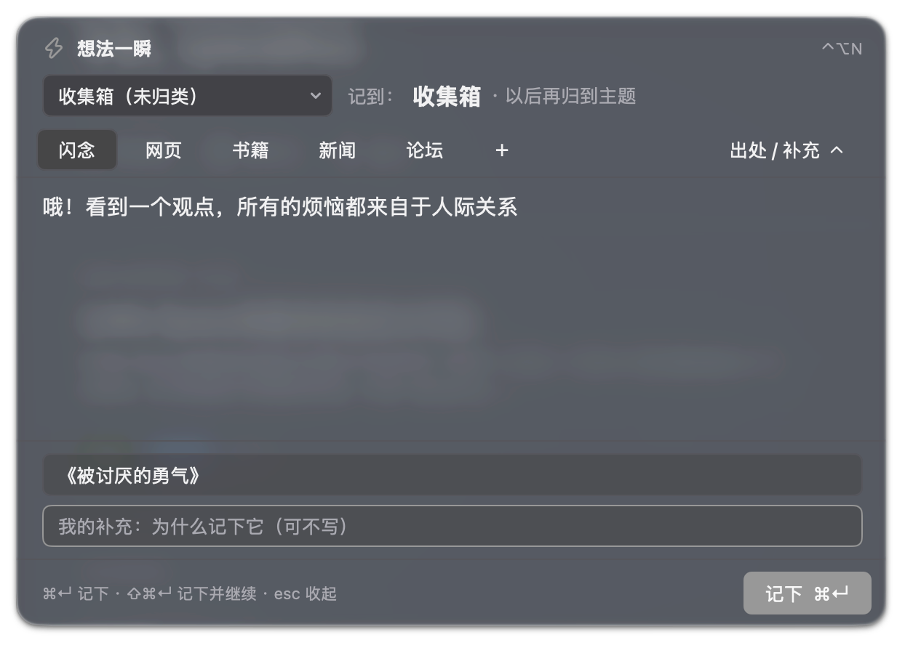
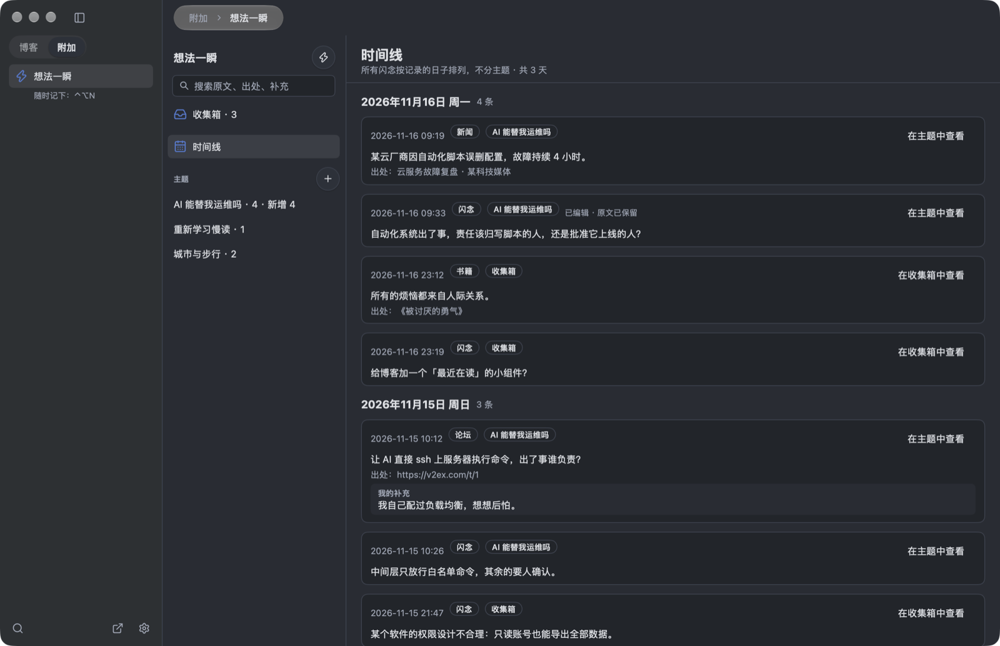

<!-- Generated from apps/desktop/README.md by `go run ./internal/ghreadme` in apps/desktop. Do not edit: edit that file and run it again. -->

# Mix Space Desktop

Mix Space 后台的桌面客户端，基于 [MyGo](https://mygo.run) 和 [Onevra](https://github.com/oneo-me/onevra) 构建（版本都锁定在 `go.mod` 中）。

它是 Web 后台的原生外壳：窗口、侧边栏、菜单栏、命令面板和设置窗口是原生的，内容区就是服务端在 `/proxy/qaqdmin` 提供的 Web 后台，显示在 web view 里。客户端本身不实现后台功能，所以服务端升级后，桌面端无需发版就能用上新版后台。

优先支持 macOS，Windows 和 Linux 使用同一份代码构建。

<p align="center">
  
</p>

## 维护边界：不修改 mx-core 核心代码

这个应用作为 mx-core 的桌面客户端单独维护，**所有改动都限定在 `apps/desktop/` 目录内**，不修改 `apps/core`（服务端）、`apps/admin`（Web 后台）和共享包。

唯一的例外是 `.github/README.md`：它让 GitHub 仓库首页显示这份介绍（GitHub 优先显示 `.github/README.md`，所以根目录的 mx-core README 保持不动）。它由 `apps/desktop/README.md` 生成，不要直接编辑：改完 `apps/desktop/README.md` 后，在 `apps/desktop` 里运行 `go run ./internal/ghreadme`（`go generate` 也会运行它）。两份不一致时 `go test ./...` 会失败。

它只使用 mx-core 已经公开的能力，对它们只读、不改：

| 依赖的上游能力 | 位置 | 用途 |
| --- | --- | --- |
| Web 后台页面 `/proxy/qaqdmin` | `apps/core` pageproxy | 内容区的 web view |
| Better Auth `/auth/ok`、设备授权、`/device/web-handoff` | `apps/core` auth | 探测服务器、Passkey 登录、把令牌换成后台 Cookie |
| 设备客户端 `mxs-cli` | `apps/core/src/modules/auth/auth.constant.ts` | 服务端只接受白名单里的客户端，桌面端借用 CLI 的，所以授权页显示 “Mix Space CLI” |
| 路由元数据、中英文标题、Lucide 图标 | `apps/admin/src/views/**/page.tsx` | 生成原生侧边栏（`go generate`） |
| 存储键 `admin:sidebar-collapsed`、`theme-mode`、`mx-admin-ui-locale`，两个 `aria-label`，`index.html` 里的 `#app`、`#initial-loader` | `apps/admin` | 预加载脚本：收起 Web 侧边栏，同步外观和语言，判断页面何时加载完成 |
| 写作页的编辑器和顶栏（见 `docs/writing-plan.md`） | `apps/admin` 写作页 | 预加载脚本：字数、专注模式样式、打字机滚动 |
| 页面顶栏的标题块：带 `MobileHeaderAffordance`（上面两个 `aria-label` 的按钮）和 `h1`/`h2` 的那个元素，以及标题旁的数字 | `apps/admin` 各页面顶栏 | `inject/page.css`：原生标题栏已显示页面名时，隐藏网页标题，计数移进玻璃面包屑 |
| 草稿接口 `POST /drafts`（同源请求，带后台 Cookie；Lexical 格式），写作页 `#/posts/edit?draftId=`、`#/notes/edit?draftId=` | `apps/core` draft、`apps/admin` 写作页 | 想法一瞬：把主题或勾选的闪念推送为草稿并打开；`GET /drafts/:id` 检查推送过的草稿是否还在 |
| 写作页 AI 助手按钮 `aria-label`「AI 助手」/「AI assistant」（打开后 `aria-pressed="true"`），输入框 `placeholder`「输入修改要求」/「Describe what to change」 | `apps/admin` 写作页 | 预加载脚本：打开 AI 助手并预填提示词（不发送） |
| 设计 token（`--color-*`）、Tailwind 灰阶 `--color-neutral-*`、编辑器的 `--rc-host-*`、`<html>` 上的 `.dark` | `apps/admin/src/styles/tokens.css`、`@haklex/rich-editor` | 配色主题（`inject/themes/*.css`） |

上游变化时，在这里适配，不去改上游：

- 后台增删页面：在 `apps/desktop` 里运行 `go generate`（需要先 `pnpm install`），检查 `nav_gen.go` 和 `icons/` 的 diff。
- 后台改了存储键、`aria-label` 或 `#app`/`#initial-loader`：更新 `inject/` 里的脚本和样式。不更新的话，Web 侧边栏的按钮会重新出现，加载转圈要等 8 秒超时才消失，但不影响使用。
- 服务端改了认证接口：更新 `auth.go` 和 `server.go`。

如果某项功能确实需要服务端配合（比如给桌面端单独注册一个设备客户端），应当另向 mx-core 提 PR，不要放在这个应用的改动里。

## 功能

### 原生窗口与侧边栏

Onevra 的侧边栏外壳：macOS 上有标题栏材质，Windows 上有 Mica。侧边栏可以拖动调宽、折叠，从后台路由自动生成，并跟随当前页面高亮。标题栏显示面包屑，点击上级可以跳回去。

标题栏的面包屑是悬浮的液态玻璃胶囊。页面就是侧边栏里的某一项时（比如“博文”“读者”“速记”“写手记”），网页顶栏里重复的标题和图标会隐藏，标题旁的计数（“草稿箱 10”的 10）移到面包屑里；右侧的筛选、“新建”等按钮和下方的摘要行保留在原位，顶栏只剩标题时整行隐藏。详情页等不在侧边栏里的页面，网页标题照常显示。原生标题栏整行是窗口拖动区，点不到下面的网页，所以网页按钮不移进标题栏那一行。

在 macOS 上，点关闭按钮或 `⌘W` 只隐藏窗口，应用留在后台继续运行（后台的 WebSocket 通知照常收到），点 Dock 图标恢复原样；`⌘Q` 才退出。Windows 和 Linux 上没有托盘图标，关闭窗口仍然退出应用。

### 命令面板 `⌘K`

<p align="center">
  
</p>

可以用中文、英文或路径搜到任意后台页面，也能执行刷新、前进后退、切换外观或语言、更换服务器、退出登录等操作。

`⌘K` 不是菜单快捷键，而是视图快捷键：后台编辑器自己绑定了 `⌘K`（插入链接），页面处理过的按键会留给页面。

### 写作

写作页（写博文、写手记、写页面）上的原生增强，规划见 [docs/writing-plan.md](../apps/desktop/docs/writing-plan.md)：

- **专注模式 `⇧⌘F`**：在当前窗口内铺满（不进入系统全屏），收起侧边栏、隐藏写作页顶栏。再按一次即恢复。
- **打字机滚动**：光标所在行停在略高于中间的位置，在“显示”菜单或设置球里开关，设置会保存。
- **液态玻璃**：写作页上网页铺满窗口，标题栏的面包屑和右下角的设置球都是悬浮的玻璃（MyGo glass 插件，macOS 26 及以上是系统原生 Liquid Glass，能透出下面的正文）。
- **设置球**：点开后向左展开统计（正文字数，写作时长“本次 4m · 累计 1h 20m”，累计按文章存在本机、只在窗口显示时计时）、专注和打字机两个开关，再点收起。

<p align="center">
  
</p>

上图是写手记的页面：左上是玻璃面包屑「手记 › 写手记」，网页里重复的返回按钮、标题和草稿状态已经隐藏；右下是展开的设置球，显示字数、本次和累计写作时长，以及专注、打字机两个开关。

<p align="center">
  
</p>

打开专注和打字机后：侧边栏和写作页顶栏都收起，正文铺满窗口；面包屑和设置球是悬浮在正文上的玻璃，滚动时下面的文字会从玻璃后面透出来；正在写的那一行停在窗口中间偏上的位置。

### 想法一瞬 `⌃⌥N`

先记下，以后再整理：在任何应用里按 `⌃⌥N`（默认，可改），会弹出「想法一瞬」面板。面板悬浮在所有窗口之上（类似 Spotlight），不会把当前应用切走。

<p align="center">
  
</p>

- **直接写**：输入或粘贴内容，按 `⌘↵` 记下并收起，`⇧⌘↵` 记下后继续写下一条，`Esc` 收起。没记下的内容会保留。
- **记到哪**：每次唤起时默认是**收集箱**（未归类），也可以在下拉框里选一个主题，或「＋ 新建主题…」。选了主题后，用 `⇧⌘↵` 连续记录时会一直记到这个主题。主题是长期积累素材的容器，不是文章标题。
- **来源**：默认「闪念」，每次记下后都会回到「闪念」。可选网页、书籍、新闻、论坛，「＋」能加自己的来源。来源只说明内容从哪里来，不代表它是事实还是观点。
- **出处 / 补充**（默认收起）：出处可以填链接、书名、作者或帖子；粘贴的内容里如果有链接，会自动填进出处。「我的补充」用来写自己的看法或为什么记下它，和原文分开保存。都可以不填。

内容只存在本机，在用户数据目录的 `ideas/` 下：

- 每个主题一个文件，放在 `topics/`，包括它引用的别处闪念（只记 ID）和每次推送的记录；
- 每条闪念一个文件，放在 `entries/`，记录 ID、记录时间、所属主题（空表示收集箱）、来源、原文、出处、我的补充；
- 编辑后，第一次的原文保存在 `original` 里；
- 从收集箱直接推送的记录放在 `index.json`；
- 记下时只认主题 ID，并在写入前从磁盘重新读取主题。如果主题已经删除，会直接报错，不会写进别处；
- 以后 AI 生成的标签、关联、摘要放在单独的 `ai/` 目录（还没实现），每条建议记下它依据的闪念 ID 和用户是否采纳，不会改动原文。

侧边栏顶部分成「博客」和「附加」两个选项卡：「博客」是后台的页面，「附加」放桌面端自己的功能。

在「附加 › 想法一瞬」里可以整理素材：

<p align="center">
  
</p>

上图是一个主题：顶部是推送状态（推送过几次、之后新增几条），每条闪念标出来源、「新增」「引自 城市与步行」「已编辑 · 原文已保留」，下方是推送按钮。
- 左边是搜索框、收集箱、时间线和主题。
- **搜索**：在所有闪念的原文、出处、我的补充和来源里查找，空格分开的几个词要同时出现。点「在主题中查看」会跳到那一条并标出来。
- **时间线**：所有闪念按记录的日子排列，最近的日子在前，不分主题，用来回看某段时间都在想什么。
- 每条闪念可以编辑，出处分成链接、标题、作者、原文发布时间四项填写。
- 每条闪念可以移到别的主题（包括新建一个），也可以**引用到其他主题**：它仍属于原来的位置，只是也算那个主题的素材，推送时一并带上。引用的条目标「引自 X」，可以取消引用；原条目下会显示「也被引用于」。
- **多选**：在收集箱或主题里勾选几条，一起移到某个主题，或直接推送成草稿。从收集箱推送时要起一个暂定标题，不会为此新建主题。
- 删除主题时，里面的闪念会移回收集箱，不会被删除。

<p align="center">
  
</p>

在主题里点 **推送为手记草稿…** 或 **推送为博文草稿…**（或勾选后推送）时，先显示**预览**：草稿标题、素材说明和每条素材的表格，以及共几条、新增几条、引自别处几条。

<p align="center">
  
</p>

确认生成后，会依次发生：

1. 在后台页面里调用 `POST /drafts`，以 Lexical 格式创建草稿，因为写作页的 AI 助手只支持 Lexical。
   - 标题用主题名，讨论后再改。
   - 正文开头是一段「素材说明」，写明这是未经整理的闪念素材、不是正式文章。
   - 之后每条素材是一张「序号 | 记录时间 | 来源 | 出处」的小表格（引用的素材多一列「引自」），加上原文和「我的补充」，条目之间用分隔线隔开。
2. 打开草稿的写作页，自动打开 AI 助手并填好提示词，**但不发送**，由你修改或发送。提示词要求 AI 先讨论、不写正文：
   - 概括这些素材在想什么；
   - 找出共同点、矛盾和关联；
   - 区分事实、判断和推测，不只凭来源下结论；
   - 给出 2–4 个写作方向；
   - 指出还缺什么。
3. 如果后台改了 AI 助手的按钮或输入框，没能自动填入，提示词会复制到剪贴板。

推送后主题不会归档，可以继续积累。本机会记下每次推送生成的草稿和其中包含的闪念，所以能区分新增的素材：
- 列表里显示「新增 N」，卡片上标「新增」。
- 再次推送时，预览里会说明将生成一份**新**草稿：包含全部素材，新增的会标出来。
- 之前的草稿不会改动，以免覆盖你在网页端改过的内容。
- 「推送记录」列出每次推送的时间、草稿类型和条数，每份都能打开；「打开上次草稿」打开最近一份。打开前会先检查草稿是否还在；如果已经发布或删除，会提示你重新生成。

快捷键可在设置的「想法一瞬」里更换：预设有 `⌃⌥N`（推荐）、`⌥⇧Space`、`⌃⌥⌘N`、`⌥⌘N`，也可以「自定义…」，选修饰键（⌃ ⌥ ⇧ ⌘）加一个按键（字母、数字、Space、F1–F12）。至少要带 ⌃、⌥、⌘ 之一（F 键除外），以免影响打字。新快捷键注册成功后才会保存，注册失败时保留原来的；附加页、浮窗、菜单和命令面板里显示的快捷键会同步更新。没选 `⌥⌘N` 作默认，是因为新版 macOS 用它打开通知中心；系统占用的组合 app 检测不到，按下没反应时换一个即可。命令面板和「显示」菜单里也有「记一个想法」。

### 设置 `⌘,`

<p align="center">
  
  
</p>

独立的可搜索设置窗口，包含服务地址、界面语言、外观（浅色、深色、跟随系统，应用和后台一起切换）、配色主题，以及账户相关的操作。

### 配色主题

可以给后台换一套配色，目前有 **Atom**（One Light / One Dark，参照 [obsidian-atom](https://github.com/kognise/obsidian-atom)）。浅色和深色仍由“外观”决定，主题只决定两者各自的颜色。

本页开头的仪表盘和「写作」里的两张截图都是 Atom 深色、主题范围为「全局」：后台页面、编辑器，以及原生的侧边栏底色都换成了 One Dark 的蓝灰色调。

服务器上跑的通常是官方镜像，桌面端不能改后台代码，所以主题是预加载脚本注入的一份 CSS（`inject/themes/<id>.css`）。它覆盖后台和编辑器读取的 CSS 变量：后台的设计 token、Tailwind 的灰阶和彩色色阶（徽标、状态色换成 Atom 的色相）、编辑器 `@haklex/rich-editor` 留给宿主页面的 `--rc-host-*`，以及代码编辑器（Monaco、CodeMirror）的背景。所有规则都限定在 `<html data-mx-theme="<id>">` 下，属性由预加载脚本按“主题范围”设置：

- **仅写作页**（默认）：只在写博文、手记、页面（包括编辑草稿）时换色，按写作页逐项适配；原生侧边栏和窗口保持原有配色。
- **全局**：后台所有页面一起换色，原生界面（侧边栏底色、命令面板、设置窗口）也换成主题配色。后台由服务器提供，部分页面可能不一致，设置里会提示。

换色前脚本会检查页面是否定义了主题要覆盖的变量。如果后台改了名，就不套用主题，弹出提示，原生界面也恢复原有配色。

新增主题：在 `inject/themes/` 下放一个 `<id>.css`，并在 `themes.go` 的 `colorThemes` 里加一项（名称和原生界面的浅色、深色配色）。设置和命令面板会自动列出它。

### 连接与登录

<p align="center">
  
  
</p>

- **密码**：在 web view 里使用后台自己的登录表单。
- **Passkey**：在系统浏览器中完成设备授权（`auth.go`），与 mxs CLI 和 iOS 客户端的方式相同。浏览器里用 Passkey 登录并确认验证码后，应用把会话令牌存进钥匙串，再通过 `/device/web-handoff` 换成后台的 Cookie。之后启动时如果 Cookie 已过期，会自动用钥匙串里的令牌重新登录。

连接失败、登录成功、失败或过期、退出登录，都会用 Toast 提示。

## 开发

需要 Go 1.27 及以上。

```sh
cd apps/desktop
go tool mygo dev     # 运行并热重载
go test ./...        # 测试，包括各界面的无界面渲染
go tool mygo build   # 生成 build/darwin-arm64/Mix Space.app 和 .dmg
```

截图是原生界面的无界面渲染（Web 后台部分留空）。界面改动后重新生成：

```sh
README_SCREENSHOTS=docs/screenshots go test -run TestReadmeScreenshots
```

`SCREENSHOTS=<dir> go test -run TestScreens` 会把测试里渲染的各个界面保存为 PNG，方便检查。

修改 `apps/desktop/README.md` 后，运行 `go run ./internal/ghreadme` 同步仓库首页的 `.github/README.md`。

## 代码结构

| 文件 | 内容 |
| --- | --- |
| `main.go` | 应用状态、连接、web view、登录流程 |
| `views.go` | 窗口外壳、侧边栏、标题栏面包屑，以及设置、登录、错误页 |
| `palette.go` | `⌘K` 命令面板 |
| `ideas.go` / `idea_panel.go` / `ideas_view.go` / `ideas_draft.go` | 想法一瞬：本机存储（主题、闪念、引用、推送记录、搜索）、全局快捷键面板、「附加」里的整理页（时间线、多选、预览）、推送草稿并预填 AI |
| `pagefetch.go` | 在后台页面里用后台的 Cookie 调用 API |
| `prefs.go` | `⌘,` 设置窗口 |
| `menu.go` | 菜单栏 |
| `inject/` | 注入 Web 后台页面的全部改动：预加载脚本 `preload.js`、改后台界面的样式 `page.css`、配色主题 `themes/`。后台的 DOM 依赖都集中在这里 |
| `inject.go` / `bridge.go` | 嵌入并组装预加载脚本；页面调用的 Go 端接口 |
| `auth.go` / `server.go` | 设备授权、令牌交换、服务器探测 |
| `nav.go` / `nav_gen.go` / `icons/` | 侧边栏数据（`nav_gen.go` 和 `icons/` 是生成的），以及「附加」选项卡的 `extraItems` |
| `internal/gennav` | 侧边栏生成器 |
| `internal/ghreadme` | 由 `README.md` 生成 `.github/README.md` |

主题使用 MyGo 默认主题，没有用 Onevra 的配色，这样原生部分和 Web 后台的观感更接近。
