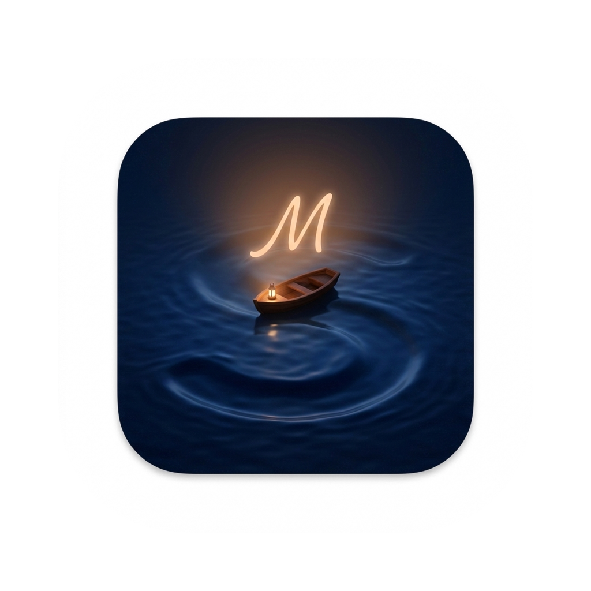
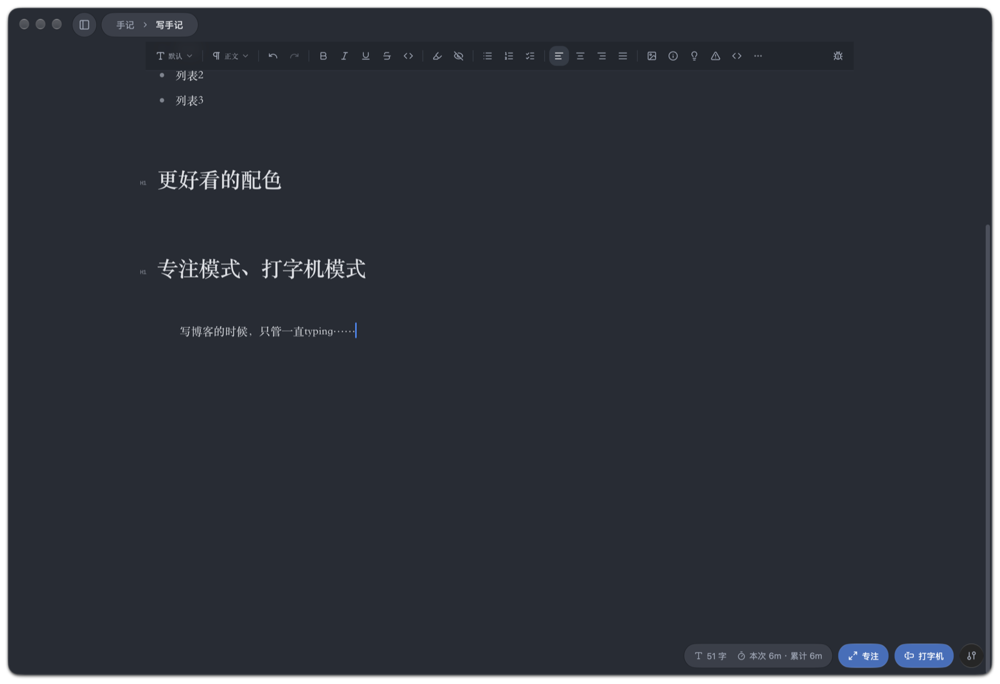
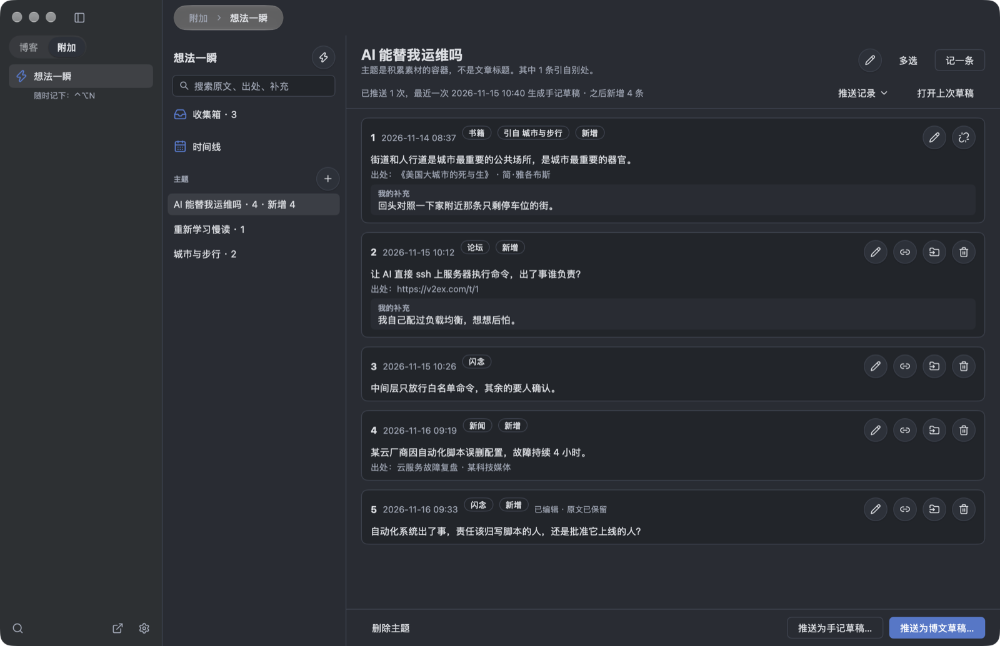
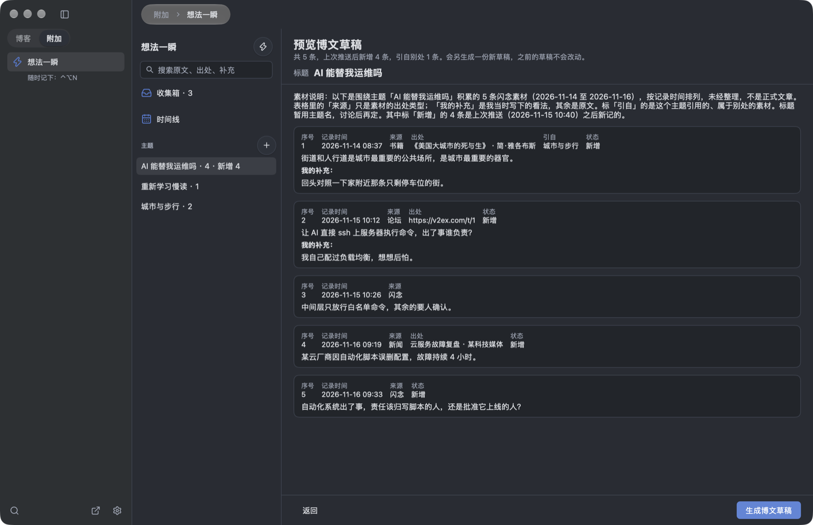

<!-- Generated from apps/desktop/README.md by `go run ./internal/ghreadme` in apps/desktop. Do not edit: edit that file and run it again. -->

<p align="center">
  
</p>

<h1 align="center">Mix Desk</h1>

<p align="center">Mix Space 博客后台的桌面客户端（macOS 优先，Windows / Linux 同源构建）。</p>

## 是什么

一个原生外壳包着 Web 后台：窗口、侧边栏、命令面板、设置等是原生界面，内容区直接加载服务端 `/proxy/qaqdmin` 提供的 Web 后台。客户端不重新实现后台功能，服务端升级后无需发版即可用上新后台。

基于 [MyGo](https://mygo.run) 和 [Onevra](https://github.com/oneo-me/onevra) 构建。

## 功能

- **原生外壳**：可调宽、可折叠的侧边栏（由后台路由自动生成），玻璃面包屑；macOS 上关闭窗口后留在后台继续接收通知
- **命令面板 `⌘K`**：中英文或路径搜索任意页面，执行刷新、切换外观、退出登录等操作
- **写作增强**：专注模式 `⇧⌘F`、打字机滚动、液态玻璃设置球（字数、写作时长）
- **想法一瞬 `⌃⌥N`**：在任何应用里唤出悬浮面板记下闪念；按主题整理、时间线回看、搜索，再推送为博文 / 手记草稿并预填 AI 助手提示词。数据只存在本机
- **配色主题**：Atom（One Light / One Dark），可仅作用于写作页或全局
- **设置 `⌘,`**：服务地址、界面语言、外观、主题、账户
- **登录**：后台密码登录，或通过系统浏览器用 Passkey 完成设备授权，令牌存入钥匙串

## 截图

<table>
  <tr>
    <td colspan="2"><br/><sub>仪表盘 · Atom 深色</sub></td>
  </tr>
  <tr>
    <td width="50%"><br/><sub>写作页 · 玻璃面包屑与设置球</sub></td>
    <td width="50%"><br/><sub>专注模式 + 打字机滚动</sub></td>
  </tr>
  <tr>
    <td width="50%"><br/><sub>想法一瞬 · 悬浮面板</sub></td>
    <td width="50%"><br/><sub>想法一瞬 · 主题</sub></td>
  </tr>
  <tr>
    <td width="50%"><br/><sub>想法一瞬 · 时间线</sub></td>
    <td width="50%"><br/><sub>想法一瞬 · 推送预览</sub></td>
  </tr>
</table>

## 使用

1. 从 [Releases](https://github.com/specialhua/mix-desk/releases) 下载安装包，或按下文自行构建。
2. 首次启动输入 Mix Space 服务地址，用密码或 Passkey 登录。

| 快捷键 | 作用 |
| --- | --- |
| `⌘K` | 命令面板 |
| `⌘,` | 设置 |
| `⇧⌘F` | 写作页专注模式 |
| `⌃⌥N` | 想法一瞬（全局，可在设置中更换） |

## 开发

需要 Go 1.27+。

```sh
cd apps/desktop
go tool mygo dev     # 运行并热重载
go test ./...        # 测试
go tool mygo build   # 打包到 build/
go generate          # 后台增删页面后，重新生成侧边栏
```

修改本文件后运行 `go run ./internal/ghreadme`，同步仓库首页的 `.github/README.md`。

## 项目结构

本仓库是 mx-core 的 fork，**本项目只维护 `apps/desktop/`**，不改动服务端、Web 后台和共享包（唯一例外是由本文件生成的 `.github/README.md`）。依赖的上游能力及适配方式见 [docs/upstream.md](../apps/desktop/docs/upstream.md)。

```
mx-core/
├── .github/README.md        # 由 apps/desktop/README.md 生成
├── apps/
│   ├── core/                # 服务端（上游）
│   ├── admin/               # Web 后台（上游）
│   ├── desktop/             # ★ 本项目
│   │   ├── main.go          # 应用状态、连接、web view、登录流程
│   │   ├── views.go         # 窗口外壳、侧边栏、面包屑、设置 / 登录 / 错误页
│   │   ├── palette.go       # ⌘K 命令面板
│   │   ├── prefs.go         # ⌘, 设置窗口
│   │   ├── menu.go          # 菜单栏
│   │   ├── writing.go       # 写作增强
│   │   ├── themes.go        # 配色主题
│   │   ├── ideas*.go        # 想法一瞬：存储、整理页、推送草稿
│   │   ├── idea_panel.go    # 想法一瞬悬浮面板与全局快捷键
│   │   ├── auth.go          # Passkey 设备授权、令牌交换
│   │   ├── server.go        # 服务器探测
│   │   ├── pagefetch.go     # 在后台页面内调用 API
│   │   ├── nav.go           # 侧边栏数据（nav_gen.go、icons/ 为生成文件）
│   │   ├── inject/          # 注入 Web 后台的脚本、样式和配色主题
│   │   ├── internal/        # 侧边栏生成器、.github README 生成器
│   │   └── docs/            # 截图与设计文档
│   └── …                    # 其他上游应用
└── packages/                # 共享包（上游）
```
